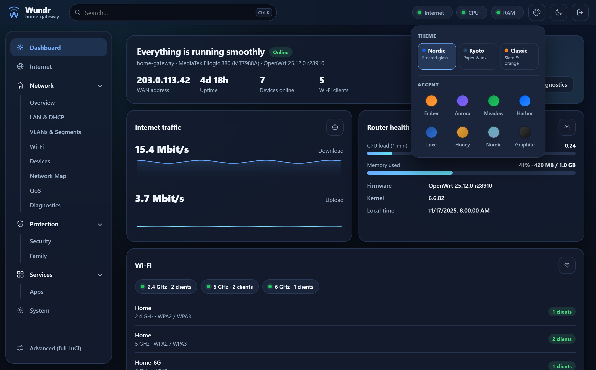
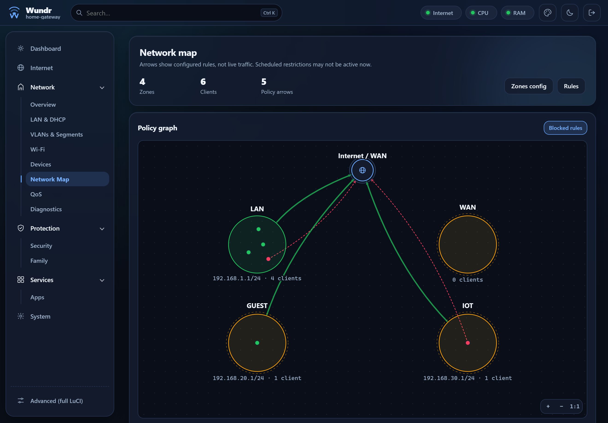

<div align="center">


# Wundr

Modern LuCI theme and management UI for OpenWrt.

OpenWrt 23.05 · 24.10 · 25.12+ &nbsp;·&nbsp; `opkg` & `apk` &nbsp;·&nbsp; Offline · ~40 KB gz &nbsp;·&nbsp; Apache-2.0

</div>

<br>



<br>

Wundr uses stock LuCI to save router settings. Wi-Fi and VLAN changes use LuCI's checked apply with rollback; quick actions such as pausing a device or adding a port forward apply without that timer. The theme needs no external fonts, CDNs, or background services.

Install both packages for the full interface, or `luci-theme-wundr` alone to skin stock LuCI.

<br>

## Themes

Switch between three built-in looks, Light or Dark mode, and eight WCAG AA color accents from the top bar.

| Theme | Description |
| :--- | :--- |
| **Nordic** *(Default)* | Translucent frosted cards and a detached sidebar on desktop. |
| **Kyoto** | Warm paper in light mode, dark charcoal at night, and flat divider rows. |
| **Classic** | Neutral slate cards with orange status accents. |

<table>
  <tr>
    <td width="50%">
      
      <p align="center"><sub><b>Kyoto · Light</b> · Multi-band Wi-Fi &amp; QR sharing</sub></p>
    </td>
    <td width="50%">
      
      <p align="center"><sub><b>Classic · Dark</b> · Firewall audit &amp; port forwards</sub></p>
    </td>
  </tr>
</table>

<br>

## Network Map

Shows configured firewall zones, forwardings, and Wundr pause rules alongside reported IPv4 DHCP leases. A lease is not proof that a device is online, and an arrow is not a traffic measurement. Select a client to see its address and zone.



<br>

## What's Included

| Section | Coverage |
| :--- | :--- |
| **Dashboard** | Live WAN throughput charts, CPU/RAM status rail, Wi-Fi QR sharing, and `Ctrl + K` search. |
| **Internet & LAN** | DHCP, PPPoE, Static IP, MAC clone, MTU, IPv6 SLAAC/DHCPv6, and static DHCP leases. |
| **VLANs** | Guided `802.1Q` bridge-VLAN editor (`br-lan.<vid>`, DHCP pool, firewall zone, port tag matrix). |
| **Wi-Fi & Devices** | `2.4 / 5 / 6 GHz` (`HT` to `EHT320`), guest Wi-Fi wizard, live dBm signal bars, and device pause. |
| **Family & Security** | Per-person `fw4` bedtime schedules, firewall posture checks, and quick port forwarding. |
| **QoS, Apps & System** | `cake` / `fq_codel` SQM shaping, service controls (`AdGuard`, `Tailscale`, `WireGuard`, `banIP`), ping/trace, and logs. |

<br>

## Install

Download the universal (`all`) packages for your OpenWrt release from [**Releases**](https://github.com/Gabanaut/wundr/releases).

**OpenWrt 24.10 & 23.05 (`opkg`)**

```sh
scp luci-theme-wundr_*_all.ipk luci-app-wundr_*_all.ipk root@192.168.1.1:/tmp/
ssh root@192.168.1.1 'opkg install /tmp/luci-theme-wundr_*_all.ipk /tmp/luci-app-wundr_*_all.ipk && /etc/init.d/rpcd restart'
```

**OpenWrt 25.12+ (`apk`)**

```sh
scp luci-theme-wundr-*.apk luci-app-wundr-*.apk root@192.168.1.1:/tmp/
ssh root@192.168.1.1 'apk add --allow-untrusted /tmp/luci-theme-wundr-*.apk /tmp/luci-app-wundr-*.apk && /etc/init.d/rpcd restart'
```

SDK build instructions and uninstall steps are in [docs/PACKAGING.md](docs/PACKAGING.md).

<br>

## Test & License

The screenshots show the shipped views with simulated router data. The local tests do not verify Wi-Fi connectivity, VLAN isolation, or rollback on physical hardware.

```sh
sh smoke/qa-static.sh
```

Licensed under Apache-2.0. See [LICENSE](LICENSE) and [NOTICE](NOTICE).


