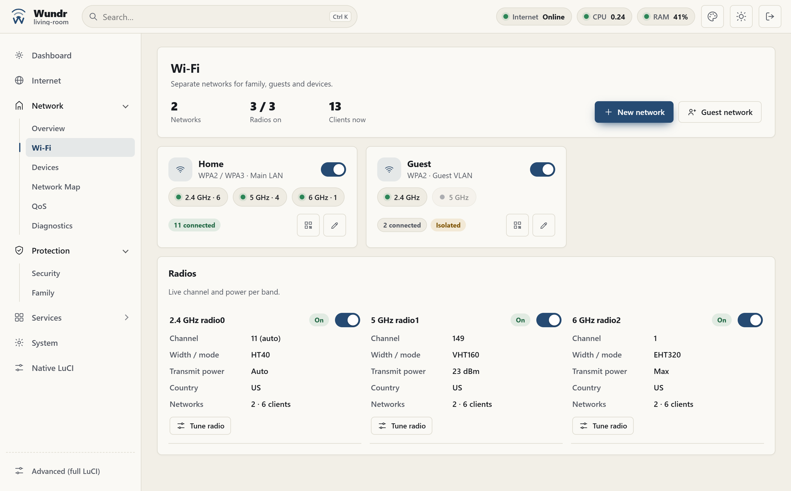
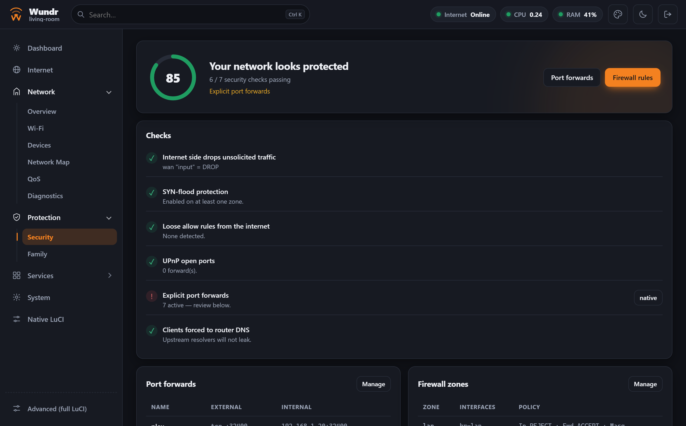

<div align="center">


# Wundr

**A calm, studio-crafted interface and LuCI theme for OpenWrt.**

OpenWrt 23.05 · 24.10 · 25.12+ &nbsp;·&nbsp; `opkg` & `apk` &nbsp;·&nbsp; 100% Offline &nbsp;·&nbsp; Apache-2.0

</div>

<br>


<br>

Wundr makes everyday router tasks effortless while keeping stock OpenWrt intact underneath. Every setting commits through LuCI's native UCI validation and 90-second rollback guard—no external CDNs, no telemetry, and ~40 KB gzipped total.

<br>

## Studio Triad

Switch instantly between three architectural finishes, Light or Dark mode, and eight WCAG AA–verified color accents from the top bar.

| Finish | Materiality |
| :--- | :--- |
| **Nordic Glass** *(Default)* | Frosted acrylic surfaces, subtle Fjord glow, and a floating sidebar island. |
| **Kyoto Sumi** | Warm *washi* paper by day, deep *sumi* charcoal by night, and quiet ledger rows. |
| **Classic** | Crisp neutral slate with warm ember accents and tactile card elevation. |

<table>
  <tr>
    <td width="50%">
      
      <p align="center"><sub><b>Kyoto Sumi · Light</b> — Multi-band Wi-Fi 7 &amp; QR sharing</sub></p>
    </td>
    <td width="50%">
      
      <p align="center"><sub><b>Classic · Dark</b> — Firewall posture &amp; port forwards</sub></p>
    </td>
  </tr>
</table>

<br>

## Policy Network Map

Every curve reflects an actual `/etc/config/firewall` forwarding or device rule—never guessed. Hover any segment or client to isolate its policy paths, or click a dot to inspect it.


<br>

## Everything You Need

| Area | Included |
| :--- | :--- |
| **Dashboard & Search** | Live WAN sparklines, CPU/RAM health rail, offline Wi-Fi QR generator, and `Ctrl + K` page search. |
| **Internet & VLANs** | DHCP, PPPoE, Static IP, MAC clone, IPv6 SLAAC/DHCPv6, static leases, and guided `802.1Q` VLAN segments. |
| **Wi-Fi & Devices** | `2.4 / 5 / 6 GHz` (`HT`–`EHT320`), one-tap guest network wizard, live signal bars, and device pause. |
| **Family & Security** | Kernel-enforced `fw4` bedtime schedules, firewall posture audit, and quick port forwarding. |
| **QoS, Apps & System** | `cake` / `fq_codel` SQM shaping, service controls (`AdGuard`, `Tailscale`, `WireGuard`, `banIP`…), ping/trace, and logs. |
| **Native LuCI** | Slide-out drawer for every stock OpenWrt page—or install `luci-theme-wundr` standalone. |

<br>

## Install

Grab the universal (`all`) packages for your OpenWrt version from [**Releases**](https://github.com/Gabanaut/wundr/releases).

**OpenWrt 24.10 & 23.05 (`opkg`)**

```sh
scp luci-theme-wundr_*_all.ipk luci-app-wundr_*_all.ipk root@192.168.1.1:/tmp/
ssh root@192.168.1.1 'opkg install /tmp/luci-theme-wundr_*_all.ipk /tmp/luci-app-wundr_*_all.ipk && /etc/init.d/rpcd restart'
```

**OpenWrt 25.12+ (`apk`)**

```sh
scp luci-theme-wundr-*.apk luci-app-wundr-*.apk root@192.168.1.1:/tmp/
ssh root@192.168.1.1 'apk add --allow-untrusted /tmp/luci-theme-wundr-*.apk /tmp/luci-app-wundr-*.apk && /etc/init.d/rpcd restart'
```

For SDK builds, theme-only setup, or clean uninstall commands, see [docs/PACKAGING.md](docs/PACKAGING.md).

<br>

## Verify & License

```sh
sh smoke/qa-static.sh   # syntax, WCAG AA contrast, QR round-trip, map geometry & OpenWrt 24/25 checks
```

Apache-2.0 — see [LICENSE](LICENSE) and [NOTICE](NOTICE).


